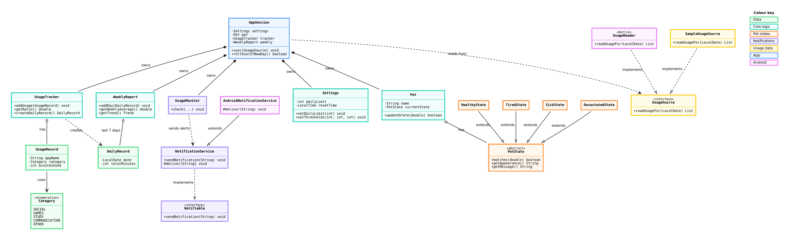

# 🐾 LOS:ER (Life Observer System: Endangered Reality) 🐾

**Course:** OOP 101 – Object-Oriented Programming (Batangas State University, Alangilan Campus – CICS)
**Team:** LOSER · Team 13 · Section IT-2112 · First Semester, AY 2026-2027

LOS:ER is an Android app that turns your daily screen time into a pet whose health depends on how long you use your phone.

## ✧ Overview ✧

Excessive smartphone use costs people sleep, study time and time with family. LOS:ER shows the cost in a way that is easy to feel: you look after a pet named Mochi, and the more you scroll past your own daily limit, the worse Mochi gets. The app reads your phone's usage statistics, compares them with the limit you set, and updates the pet and your weekly history. Everything stays on the device.

- **Four pet states:** Healthy (under 50% of the daily limit), Tired (50–80%), Sick (80–100%) and Devastated (over 100%). The percentages can be changed in Settings.
- **Daily limit and reset time:** you choose the limit and the time a new day starts.
- **Notifications:** when you are close to the limit, when you pass it, when one app is used too long in a row (60 minutes by default) and when the pet's state changes. They also arrive while the app is closed.
- **Weekly view:** the last 7 days, the daily average, the highest day and the trend.
- **Saved on the device only:** one record per day, with no internet connection and no account.

## ✧ OOP Concepts Demonstrated ✧

| Concept | Where it is used |
|---|---|
| **𝐄𝐧𝐜𝐚𝐩𝐬𝐮𝐥𝐚𝐭𝐢𝐨𝐧** | `UsageRecord`, `Settings` and `Pet` keep their fields private and change them only through validated getters and setters. |
| **𝐈𝐧𝐡𝐞𝐫𝐢𝐭𝐚𝐧𝐜𝐞** | `HealthyState`, `TiredState`, `SickState` and `DevastatedState` extend the abstract class `PetState`. `AndroidNotificationService` extends `NotificationService`. |
| **𝐏𝐨𝐥𝐲𝐦𝐨𝐫𝐩𝐡𝐢𝐬𝐦** | `Pet.updateState()` calls `matches()` on each `PetState`, and each state answers in its own way. `NotificationService.deliver()` is overridden on Android to show a real notification. |
| **𝐀𝐛𝐬𝐭𝐫𝐚𝐜𝐭𝐢𝐨𝐧** | The abstract class `PetState` and the interfaces `Notifiable` and `UsageSource` define what a class must do without saying how. |
| **𝐂𝐮𝐬𝐭𝐨𝐦 𝐞𝐱𝐜𝐞𝐩𝐭𝐢𝐨𝐧𝐬** | The checked exceptions `InvalidSettingsException` and `MissingPermissionException` report a bad setting or a missing permission. |
| **𝐀𝐫𝐫𝐚𝐲𝐋𝐢𝐬𝐭𝐬** | `UsageTracker` keeps its `UsageRecord` objects and `WeeklyReport` keeps its `DailyRecord` objects in ArrayLists. |

The core logic is written in Java. Kotlin is used only in `UsageReader`, `PermissionHelper` and `AppCategorizer`, which read Android's usage data.

## ✧ Project Structure ✧

```
📁 LOSER-OOP-Final_Project
├── 📁 src/loser                        Java core for the PC (console and tests)
│   ├── ☕ Main.java
│   ├── 📁 model          Category, UsageRecord, DailyRecord
│   ├── 📁 core           Pet, Settings, UsageTracker, WeeklyReport, TimeText
│   ├── 📁 state          PetState (abstract) and the four pet states
│   ├── 📁 notification   Notifiable, NotificationService, UsageMonitor
│   ├── 📁 exception      InvalidSettingsException, MissingPermissionException
│   ├── 📁 source         UsageSource, SampleUsageSource
│   ├── 📁 app            AppSession
│   ├── 📁 storage        RecordCodec
│   ├── 📁 ui             presenters and models for each screen
│   └── 📁 test           ☕ AllTests.java (174 self-checking tests)
├── 📁 android                          Android Studio project
│   ├── 📁 app/src/main
│   │   ├── 📄 AndroidManifest.xml
│   │   ├── 📁 java/loser     the same Java core, used by the app
│   │   │   └── 📁 android    screens, background check, storage, notifications, Kotlin usage reader
│   │   └── 📁 res            layouts, drawables, pet images, fonts, colors, texts
│   ├── 📄 build.gradle.kts, settings.gradle.kts, gradlew
│   └── 📄 FONT-LICENSE-Nunito-OFL.txt
├── 📁 docs
│   ├── 🖼️ uml-classes.png
│   ├── 📄 uml-classes.mmd
│   └── 📝 TEST-CHECKLIST.md
├── 📄 .gitignore
└── 📝 README.md
```

## ✧ Requirements ✧

- Java Development Kit (JDK) 8 or newer, to run the console version and the tests on a PC.
- Android Studio with the Android SDK, to build the app.
- An Android phone with Android 8.0 (API 26) or newer and USB debugging turned on. An emulator has almost no usage data, so a real phone is recommended.

## ✧ How to Run the Program ✧

**Console version and tests (PC)**

1. Clone the repository:
   ```
   git clone https://github.com/25-04942/LOSER-OOP-Final_Project.git
   cd LOSER-OOP-Final_Project
   ```
2. Compile the sources into an `out` folder (Windows PowerShell):
   ```
   mkdir out
   javac -encoding UTF-8 -d out (Get-ChildItem -Recurse src -Filter *.java).FullName
   ```
   On macOS or Linux use `javac -encoding UTF-8 -d out $(find src -name "*.java")`.
3. Run the 174 tests. The last line should say that all of them passed:
   ```
   java -cp out loser.test.AllTests
   ```
4. Run the console menu:
   ```
   java -cp out loser.Main
   ```

**Android app**

1. Open Android Studio, choose **File → Open**, and select the `android` folder of this repository (not the repository folder).
2. Wait for Gradle to finish syncing. Accept the Android SDK location if Android Studio asks for it.
3. Connect your phone, choose it in the device box at the top and press **Run**.
4. Follow the setup screens: name your pet, set the daily limit and the time a new day starts, then allow **Usage access** for LOS:ER in Android settings and allow notifications.

## ✧ UML Class Diagram ✧

[](docs/uml-classes.png)

## ✧ Learning Purpose ✧

This project was made for OOP 101. It shows how encapsulation, inheritance, abstraction, polymorphism, custom checked exceptions and ArrayLists work together in a real Android app, and how a team shares one GitHub repository.

## ✧ Team Members ✧

| | |
|---|---|
|  | **Alcuran, Hans Gearson S.** (GitHub: 25-04942)<br>Project Leader and Lead Developer. Wrote the core Java logic (usage records, pet states, tracker, notifications, session and saving), the Android build setup, the background usage check and the Kotlin usage reader, and manages the repository. |
|  | **Brin, Angel John D.** (GitHub: 25-04785)<br>System and Design Lead, Assistant Developer and Assets Creator. Built the app screens and their logic, the layouts, colors, fonts and pet images, and drew the UML class diagram. |
|  | **Delica, Gian Lei E.** (GitHub: 25-01723)<br>Documentation, Assistant Developer and Research Paper Editing and Revision. Wrote the tests and the console menu, the test checklist, this README and the research paper. |
